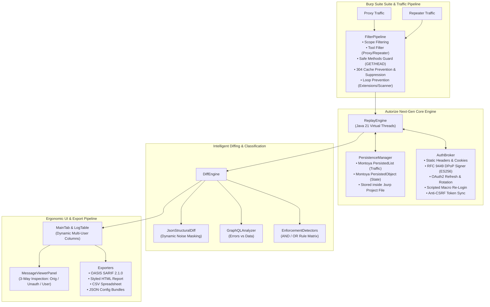

# Autorize Next-Gen (Autorize-NG)

A ground-up rewrite of Burp Suite’s Autorize on the Montoya API with automatic cross-user ID harvesting, structural JSON diffing, multi-role replay, and modern auth support (OAuth refresh, DPoP, JWT) for serious authorization testing.

[](https://openjdk.org/)
[](https://portswigger.github.io/burp-extensions-montoya-api/)
[](pom.xml)
[](LICENSE)
[](https://sarifweb.azurewebsites.net/)

**Autorize Next-Gen** is the next-generation authorization and access control security testing extension for **Burp Suite** (Professional & Community). Engineered from the ground up for modern enterprise application security in 2026, it replaces legacy Python 2.7 / Jython scripts with a high-performance, native **Java 21 LTS** extension built upon the **Montoya API**.

Autorize Next-Gen empowers penetration testers, red teamers, and application security engineers to automatically detect **Broken Object Level Authorization (BOLA / IDOR)**, **Broken Function Level Authorization (BFLA)**, and missing authentication controls across high-scale REST, GraphQL, microservices, and multi-tenant architectures.

---

## 🚀 Key Advantages Over Legacy Autorize

| Feature / Capability | Legacy Autorize (v1.x) | Autorize Next-Gen (v0.1.0) |
| :--- | :--- | :--- |
| **Runtime & Language** | Python 2.7 / Jython (`IBurpExtender`) | **Pure Java 21 LTS** via **Montoya API** |
| **Classloading & Stability** | Frequent Jython memory leaks & JVM crashes | **Native JVM speed**, zero classloader conflicts |
| **Concurrency Model** | Single-threaded / OS thread exhaustion | **Java 21 Virtual Threads (`Project Loom`)** |
| **State Persistence** | Memory-only (lost upon Burp restart) | **Native Burp Project File (`.burp`) Persistence** via `PersistedList` & `PersistedObject` |
| **Modern Auth Standards** | Basic static cookie / header replacement | **RFC 9449 DPoP**, **OAuth2 refresh/rotation**, **Macro Re-Login**, **CSRF Token Sync** |
| **JSON & IDOR Replacement** | Fragile regex substitutions | **Dot-notation JSON field mutation** (`JSON_FIELD`) |
| **Diffing Mechanism** | Naive byte-length comparisons (prone to false positives) | **Structural JSON tree diffing** with dynamic noise masking & **GraphQL analyzer** |
| **Multi-User Testing** | Single user + unauthenticated context | **Unlimited concurrent user profiles** with dynamic table columns |
| **Safety Protections** | None (can trigger destructive mutations) | **Safety Guard** (`GET`/`HEAD` safe methods enforcement) |
| **Enterprise Export** | HTML / CSV only | **OASIS SARIF 2.1.0** (GitHub Code Scanning & DefectDojo), **Rich HTML**, **CSV**, **JSON Config Bundles** |

---

## 🏗️ System Architecture



---

## 🌟 Deep Dive into Major Features

### 1. Modern Runtime & Virtual Thread Replay Engine
* **Pure Java 21 LTS**: Native compilation with zero third-party script bridges or Jython dependencies.
* **Project Loom Concurrency**: Replays for unauthenticated requests and multiple user profiles run on lightweight Virtual Threads (`Executors.newVirtualThreadPerTaskExecutor()`). Thousands of requests can execute simultaneously without freezing the Burp Suite UI or depleting thread pools.
* **Native Project File (`.burp`) Persistence**: All captured traffic messages, multi-user logs, detectors, and active configurations are stored using Montoya's `PersistedList<HttpRequestResponse>` and `PersistedObject`. When you reopen your Burp project file, your entire testing history is automatically restored.

### 2. Next-Gen Authentication Subsystem (2026 Standards)
* **RFC 9449 DPoP (Demonstrating Proof-of-Possession)**:
  * Generates and manages ephemeral or persistent EC P-256 (`ES256`) keypairs.
  * Dynamically computes the `ath` (SHA-256 access token hash), `htm` (HTTP method), and `htu` (HTTP URI) claims per request.
  * **Reactive Nonce Challenge Handler**: Catches HTTP 401 responses with `DPoP-Nonce` headers, extracts the server nonce, signs a fresh proof, and transparently retries the replay.
* **OAuth2 Token Refresh & Rotation**:
  * Supports `refresh_token` grants with automatic token rotation.
  * Supports `client_credentials` grants with HTTP Basic client authentication.
  * Tracks token freshness and executes proactive pre-replay token refreshes as well as reactive 401 retry loops.
* **Scripted Macro Re-Login**:
  * Automates multi-step re-authentication HTTP POST requests (JSON or form-urlencoded).
  * Dynamically extracts fresh tokens from JSON response paths, `Set-Cookie` directives, or custom response headers.
* **Anti-CSRF Synchronization**:
  * Automatically harvests anti-CSRF tokens from prior responses and injects them into replayed state-changing requests.
* **JWT Inspector & Live Countdown**:
  * Inspects JWT Bearer tokens, extracts claims (`sub`, `iss`, `aud`, `exp`, `iat`, custom roles), pretty-prints the payload, and displays a live real-time countdown timer.
* **Session Health Diagnostics**:
  * Dedicated session liveness testing (`SessionHealthChecker`) probes endpoints like `/api/me` or `/userinfo` with latency metrics and live status badges.

### 3. Intelligent Semantic Diffing & False-Positive Prevention
* **Structural JSON Tree Diffing**:
  * Recursively evaluates JSON object keys and value hierarchies instead of naive string matching or byte length.
  * **Dynamic Noise Masking**: Strips non-deterministic fields (`timestamp`, `date`, `nonce`, `_csrf`, `requestId`, `uuid`, `created_at`, `etag`, etc.) prior to comparison.
* **GraphQL Query & Mutation Analyzer**:
  * Detects authorization failures in GraphQL APIs returning HTTP 200 OK.
  * Inspects `errors` arrays for access denial codes (`UNAUTHENTICATED`, `FORBIDDEN`, `ACCESS_DENIED`) versus valid `data` payloads.
* **Multi-State Classification**:
  * 🟥 **`Bypassed!`**: Access control failure detected (data exposed to unauthorized context).
  * 🟩 **`Enforced!`**: Access control properly rejected unauthorized context.
  * 🟨 **`Is enforced???`**: Ambiguous divergence requiring manual tester inspection.
  * ⬜ **`Disabled`** / 🟪 **`Error`**: Inactive context or connection failure.
* **Rule Matrix**: Configurable enforcement detectors (Status codes, Header contains/not contains, Body contains/not contains, Content-Length diff, Body similarity percentage) evaluated with **AND / OR** logic.

### 4. Multi-User & Multi-Role Authorization Testing
* **Simultaneous Multi-Context Replays**: Configure unlimited user personas (e.g., *Tenant A Admin*, *Tenant B Member*, *Read-Only Auditor*, *Low-Privileged User*) alongside the unauthenticated baseline.
* **Dynamic Table Expansion**: The main table automatically expands with dedicated `[User] Len` and `[User] Status` columns for each active profile.
* **Independent User Policies**: Each user profile retains custom authentication credentials, match/replace rules, and enforcement detectors.

### 5. Advanced Match & Replace Engine
Supports granular substitution rules applied to replayed requests:
* **Headers**: Plain string or RegEx (`HEADER_STRING`, `HEADER_REGEX`).
* **URL Paths**: Plain string or RegEx (`PATH_STRING`, `PATH_REGEX`).
* **Query Parameters**: Key/value parameter substitution (`QUERY_PARAM_STRING`, `QUERY_PARAM_REGEX`).
* **Request Bodies**: Plain string or RegEx (`BODY_STRING`, `BODY_REGEX`).
* **JSON Payloads (`JSON_FIELD`)**: Dot-path object navigation and mutation (e.g., mutating `user.account.id`, `tenantId`, or `role` directly in JSON structures).

### 6. Interception Scope, Safety & Filter Pipeline
* **Tool Scope Selection**: Selectively intercept traffic from **Proxy**, **Repeater**, or both.
* **Loop Prevention**: Built-in filter automatically drops traffic generated by `ToolType.EXTENSIONS` and `ToolType.SCANNER` to eliminate infinite replay loops.
* **Safety Guard**: Safe methods only toggle (`GET`, `HEAD`) protects production databases and environments from accidental state-changing requests (`POST`, `PUT`, `DELETE`, `PATCH`).
* **HTTP 304 Handling**:
  * **Prevent 304**: Strips `If-None-Match` and `If-Modified-Since` cache headers.
  * **Ignore 304/204**: Disregards uninformative cached responses.

### 7. Rich UI & Tester Ergonomics
* **Live Quick Status & Search Filters**:
  * Real-time status checkboxes (`Bypassed!`, `Enforced!`, `Is enforced???`).
  * Live URL and HTTP Method filter text box with instant row updating.
  * Dynamic counter badge: `(Showing X / Y requests)`.
* **Flexible 3-Way Message Viewer**:
  * Inspect **Original**, **Unauthenticated**, and **User Modified** requests & responses.
  * Side-by-side or tabbed views with one-click **Maximize** mode.
* **Table Context Menu Power Actions**:
  * **Send to Repeater**: Send Original, Unauthenticated, or User Modified request directly to Burp Repeater.
  * **Send Responses to Comparer**: Immediate diffing between any pair of responses in Burp Comparer.
  * **Copy URL**, **Batch Retest**, and **Batch Delete**.
* **Global Burp Right-Click Menu**:
  * Right-click any request in Burp Proxy HTTP History or Repeater to:
    * *"Send to Autorize Next-Gen"*
    * *"Send Cookie to Autorize (User X)"*
    * *"Send Authorization to Autorize (User X)"*

### 8. Enterprise Portability & Audit Reporting
* **OASIS SARIF 2.1.0**: Machine-readable static analysis format for automated ingestion into CI/CD pipelines, GitHub Code Scanning Security tab, and DefectDojo.
* **Interactive HTML Report**: Standalone, styled HTML audit report with metrics cards and expandable details.
* **CSV Export**: Spreadsheet-ready export for engagement tracking.
* **JSON Configuration Bundles**: One-click import and export of user profiles, replacement rules, filters, and detectors.

---

## 📁 Repository Structure

```
autorize-nextgen/
├── pom.xml                                  # Maven Java 21 build & shaded fat JAR configuration
├── build.gradle                             # Gradle build configuration
├── BappManifest.bmf                         # Official Burp BApp Store manifest
├── BappDescription.html                     # BApp Store HTML description
├── README.md                                # Comprehensive documentation
└── src/
    ├── main/java/com/autorize/
    │   ├── AutorizeExtension.java           # Montoya API entry point, HTTP handler & context menus
    │   ├── auth/                            # Next-Gen Auth Engine
    │   │   ├── AuthBroker.java              # Central auth token & header coordinator
    │   │   ├── CsrfSynchronizer.java        # Dynamic anti-CSRF token synchronization
    │   │   ├── DPoPSigner.java              # RFC 9449 DPoP (ES256) & reactive nonce challenges
    │   │   ├── JwtInspector.java            # JWT Bearer parsing, claim inspector & countdown
    │   │   ├── MacroLoginProvider.java      # Scripted HTTP POST macro re-authentication
    │   │   ├── OAuth2RefreshProvider.java   # OAuth2 refresh_token & client_credentials rotation
    │   │   └── SessionHealthChecker.java    # Liveness endpoint probing & latency diagnostics
    │   ├── diff/                            # Intelligent Semantic Diffing
    │   │   ├── DiffEngine.java              # Evaluation pipeline & bypass classifier
    │   │   ├── DiffResult.java              # Result container (score, status, details)
    │   │   ├── GraphQLAnalyzer.java         # GraphQL query/mutation error analyzer
    │   │   └── JsonStructuralDiff.java      # Tree-based JSON diff with dynamic noise masking
    │   ├── export/                          # Enterprise Audit Exporters
    │   │   ├── CsvExporter.java             # CSV engagement export
    │   │   ├── HtmlExporter.java            # Styled standalone HTML report
    │   │   └── SarifExporter.java           # OASIS SARIF 2.1.0 JSON report for CI/CD
    │   ├── filter/                          # Interception & Scope Pipeline
    │   │   └── FilterPipeline.java          # Scope, tool source, regex, and 304 handling
    │   ├── model/                           # Domain Data Models
    │   │   ├── AuthMode.java                # Auth modes (STATIC, OAUTH2_REFRESH, DPOP, MACRO_LOGIN)
    │   │   ├── AutorizeConfigBundle.java    # Portable JSON export/import bundle model
    │   │   ├── EnforcementDetector.java     # Rule detector fingerprint model
    │   │   ├── EnforcementStatus.java       # Status enum (BYPASSED, ENFORCED, AMBIGUOUS, etc.)
    │   │   ├── HttpMethod.java              # HTTP method definitions
    │   │   ├── InterceptionFilter.java      # Traffic filter rule model
    │   │   ├── LogEntry.java                # Main table log model with multi-user results
    │   │   ├── MatchReplaceRule.java        # Match & Replace rule model (with JSON_FIELD)
    │   │   └── UserProfile.java             # User profile configuration model
    │   ├── persistence/                     # Native Burp Project Persistence
    │   │   └── PersistenceManager.java      # Montoya PersistedList & PersistedObject storage
    │   ├── replay/                          # Concurrency & Execution Engine
    │   │   ├── ReplayEngine.java            # Java 21 Virtual Threads replay executor
    │   │   └── SafetyGuard.java             # Safe method validator (GET/HEAD protection)
    │   └── ui/                              # Swing User Interface & Viewers
    │       ├── ConfigurationPanel.java      # Configuration modal dialog
    │       ├── DetectorConfigPanel.java     # Enforcement detectors table & logic panel
    │       ├── FilterConfigPanel.java       # Filter configuration panel
    │       ├── LogTableModel.java           # Dynamic multi-user table model
    │       ├── MainTab.java                 # Main SuiteTab, action bars & context menus
    │       ├── MatchReplacePanel.java       # Match & Replace rules table
    │       ├── MessageViewerPanel.java      # 3-Way request/response viewer with Maximize mode
    │       ├── StatusCellRenderer.java      # Color-coded cell renderer
    │       └── UserManagementPanel.java     # User profile editor, JWT inspector & diagnostics
    └── test/java/com/autorize/              # Unit & Integration Test Suites
        ├── auth/
        │   ├── DPoPSignerTest.java          # DPoP proof generation & nonce validation
        │   └── JwtInspectorTest.java        # JWT expiration & claim parsing
        ├── diff/
        │   ├── GraphQLAnalyzerTest.java     # GraphQL error response verification
        │   └── JsonStructuralDiffTest.java  # JSON noise masking & similarity calculation
        ├── model/
        │   └── AutorizeConfigBundleTest.java# Config bundle export/import roundtrip
        └── replay/
            └── ReplayEngineJsonFieldTest.java # JSON dot-notation field mutation tests
```

---

## 🛠️ Building from Source

### Prerequisites
* **Java Development Kit (JDK) 21** or higher.
* **Apache Maven 3.8+** (or use the included Gradle wrapper).

### Build via Maven
```bash
cd autorize-nextgen
mvn clean package -DskipTests=false
```

### Build via Gradle
```bash
cd autorize-nextgen
./gradlew shadowJar
```

The compiled standalone fat JAR containing all bundled dependencies will be generated at:
* `autorize-nextgen/target/autorize-nextgen-0.1.0.jar`
* `autorize-nextgen/build/libs/autorize-nextgen-0.1.0.jar`

### Running Tests
Execute the unit and integration test suite:
```bash
mvn test
```

---

## 📥 Installation in Burp Suite

### Option A: Download Pre-Built JAR (Recommended)
1. Download the latest `autorize-nextgen-0.1.0.jar` from [GitHub Releases](https://github.com/D4mianWayne/autorize-ng/releases).
2. Open **Burp Suite** (Professional or Community Edition).
3. Navigate to **Extensions** → **Installed** → click **Add**.
4. Set **Extension type** to `Java` and select the downloaded `.jar` file.
5. Click **Next** — the **Autorize Next-Gen** tab will appear in your top navigation bar.

### Option B: Build from Source
If building manually:
1. Follow the [Building from Source](#%EF%B8%8F-building-from-source) steps above.
2. In Burp Suite, go to **Extensions** → **Installed** → click **Add**.
3. Select `autorize-nextgen/target/autorize-nextgen-0.1.0.jar` (or `build/libs/autorize-nextgen-0.1.0.jar`).

---

## 📖 Practical Workflow: Step-by-Step BOLA / IDOR Testing

```
+---------------------------------------------------------------------------------------+
|  1. Configure User Profile      2. Set Interception & Safety     3. Intercept Traffic  |
|  - Paste low-privileged token    - Restrict to Target Scope       - Browse high-priv   |
|  - Or configure DPoP / OAuth2   - Enable Safe Methods Only         features in browser |
|  - Click 'Test Session Health'  - Check Unauth Enabled           - Autorize replays   |
+---------------------------------------------------------------------------------------+
                                           |
                                           v
+---------------------------------------------------------------------------------------+
|  4. Triage Results               5. Inspect & Verify              6. Export Audit      |
|  - Filter by "Bypassed!" (Red)   - 3-Way Side-by-Side Viewer      - Generate SARIF     |
|  - Search endpoints / methods    - Send to Repeater / Comparer    - Generate HTML/CSV  |
+---------------------------------------------------------------------------------------+
```

1. **Set Up Low-Privileged Context**:
   * Open the **Autorize Next-Gen** tab → click **Settings** → **User Management**.
   * Configure a low-privileged test user:
     * **Static**: Paste the low-privileged session `Cookie` or `Authorization: Bearer <token>`.
     * **OAuth2 / DPoP**: Enter token endpoint, client credentials, and enable RFC 9449 DPoP signing.
     * **Macro Login**: Provide the login endpoint and credentials payload for automated session refreshing.
   * Click **Test Session Liveness** to verify valid authentication.
2. **Configure Scope & Interception Controls**:
   * Set **Tool Interception Scope** to `Proxy`, `Repeater`, or both.
   * Enable **Safe Methods Only** (`GET`, `HEAD`) to avoid unintended database state modifications.
   * Ensure **Check Unauthenticated** is enabled to concurrently test for missing authentication.
3. **Engage Interception**:
   * Click the top-left toggle to turn **Autorize is ON** (button turns green).
4. **Browse Target Application**:
   * Authenticate into the target web application as an **Administrator / High-Privileged User** through Burp's proxy browser.
   * Navigate administrative features, API endpoints, and sensitive data views.
5. **Analyze Findings in Real Time**:
   * Review incoming requests in the log table:
     * 🟥 **Bypassed!**: The low-privileged user or unauthenticated context successfully accessed the resource.
     * 🟩 **Enforced!**: Access control denied the unauthorized request.
     * 🟨 **Is enforced???**: Potential anomaly or slight response variation requiring inspection.
   * Select any row to examine the **3-Way Message Viewer** (Original vs Unauthenticated vs Low-Privileged).
6. **Verify and Report**:
   * Right-click any row to **Send to Repeater** or **Send Responses to Comparer**.
   * Click **Export** to generate an **OASIS SARIF 2.1.0** file for GitHub Code Scanning / DefectDojo, or an interactive **HTML Audit Report**.
   * Save your Burp Project (`.burp`) at any point—all logs, profiles, and state persist automatically.

---

## 🤝 Contributing

Contributions, bug reports, and feature requests are welcome!
1. Fork the repository.
2. Create a feature branch: `git checkout -b feat/my-new-feature`.
3. Commit your changes: `git commit -m 'feat: add support for XYZ'`.
4. Ensure all tests pass: `mvn test`.
5. Push to your branch and submit a Pull Request.

---

## 📜 License

Licensed under the **Apache License, Version 2.0**. See the [LICENSE](LICENSE) file for details.
